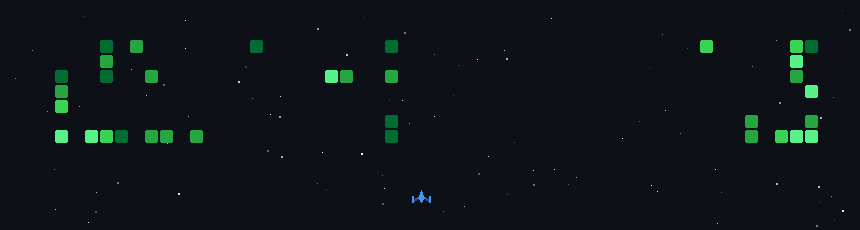

# Hi, I'm Neel 👋

### A CS + AI student at Northeastern, in Boston

[My portfolio](https://neelchandwani1.github.io)

- 🗳️ **Distributed systems** developer
- 🤖 **Machine learning**
- ⚡ **Real-time web**
- 🃏 **Game AI** I like writing bots that try to out-plan you
- 🧮 **Math** minor 
- 🦀 **Rust** and **Go** are what I'm currently learning

 

### Here are some things I know:

---

## Things I've made

- **Pulse**, a live leaderboard where friend groups rank what they're into (1,500+ active users)
- [CultivatED's website](https://cultivat-ed.vercel.app)
- [stock-predictor](https://github.com/NeelChandwani1/stock-predictor), an LSTM that tries to forecast stock prices
- [lostNfoUnd](https://github.com/NeelChandwani1/lostNfoUnd), a lost-and-found app for Northeastern

## Other skills

- Probability & stats tutor
- Professional grader of LLM answers

 

